# Meeting Report

**Turn any meeting recording into a clean transcript and a ready-to-share report. Your recordings stay private, on your own computer.**

<p align="center">
  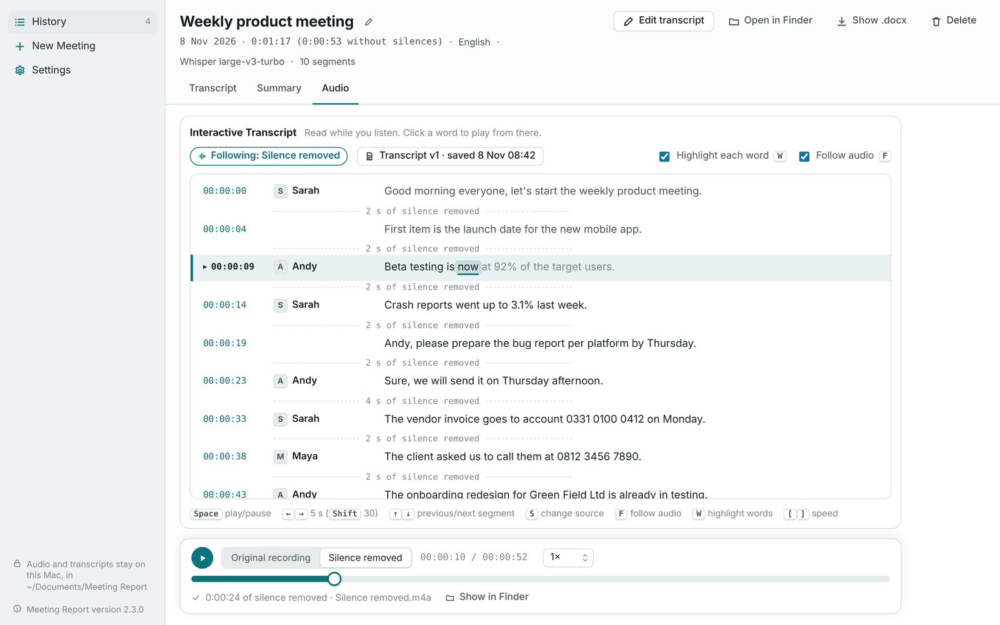
</p>

Stop replaying hour-long recordings to find who said what. Drop in a recording, and Meeting Report gives you three things:

- 📝 **A full transcript** with speaker names
- 🎧 **Silence-removed audio**: the recording with the long silences cut out
- 📄 **A meeting report** with the summary, decisions and action items, ready as Markdown or Word

Speech-to-text runs on your own device. Your confidential meetings stay confidential.

**[Get started in 5 minutes ↓](#get-started)**

---

## Why people choose Meeting Report

### 🔒 You decide what leaves your device

Recording and speech-to-text always happen on your device. Only when you ask for an AI report is the text sent to the AI you picked: after you confirm, and with sensitive details masked. Account numbers, ID numbers, phone numbers, card numbers, tax IDs, emails and your own list of sensitive words become placeholders, and are put back on your device. Parts you mark as Confidential are never sent. Want zero sharing? Use Ollama and everything stays on your device.

Pick the privacy level that fits each meeting:

| Privacy level | Where the AI report is made | What leaves your device |
| --- | --- | --- |
| 🔒🔒🔒 Fully on your device | Ollama on the same computer | Nothing |
| 🔒🔒 Inside your organization | Your company's own AI server (any OpenAI-compatible server, such as vLLM or SGLang) | Masked text, only to your own server |
| 🔒 Cloud AI | Anthropic, OpenAI or Gemini | Masked text, only after you confirm |

For confidential meetings, use the first two levels: from recording to report, nothing reaches the outside world.

Before anything is sent, you can preview the exact text. Sensitive details are already replaced by placeholders:

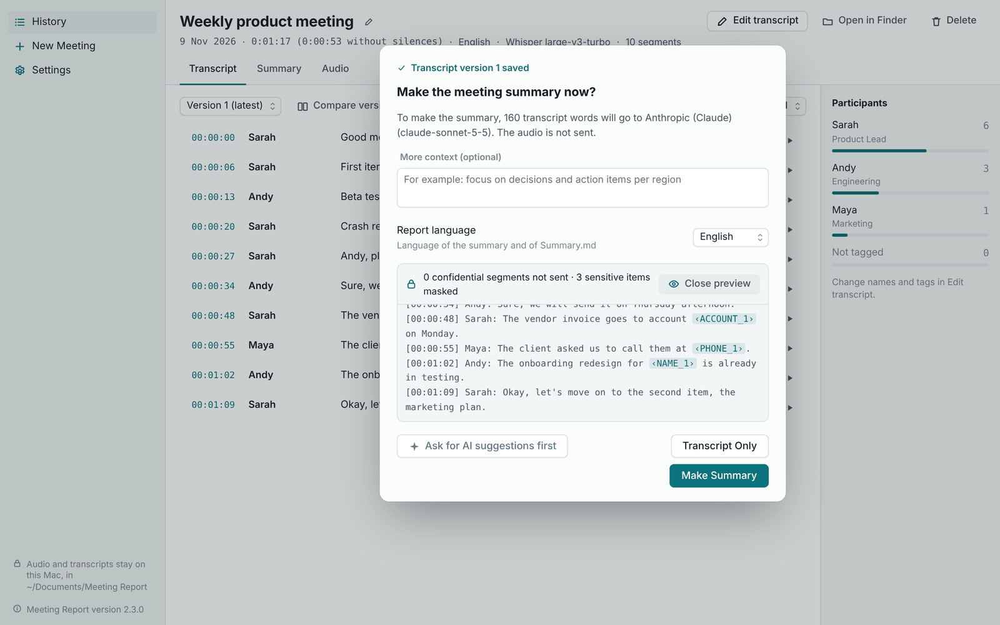

### 🤖 Your AI, your choice

Use Anthropic, OpenAI, Gemini, any OpenAI-compatible server, or Ollama running on your own device with no internet at all.

<details>
<summary>See the AI and privacy settings</summary>

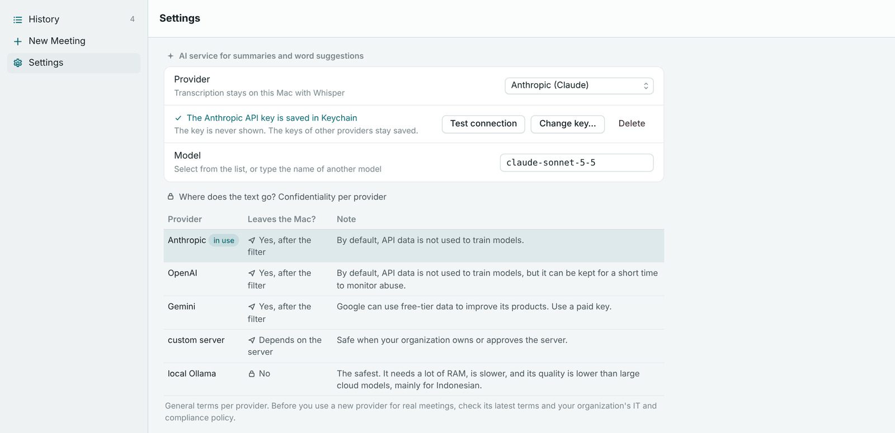

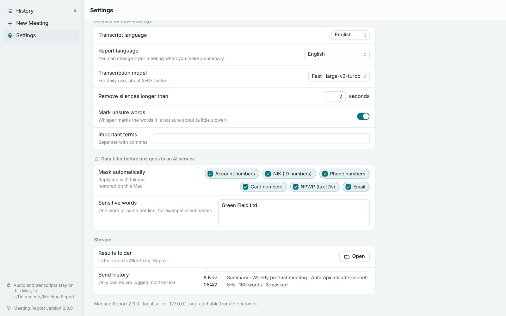

</details>

### ✅ A transcript you can trust

Parts the speech engine missed are transcribed again automatically. Edit text, search and replace, merge or split lines, and replay any line to check what was said.

### 🕘 Every change is saved

Each save creates a new version. Compare any two versions word by word and restore with one click.

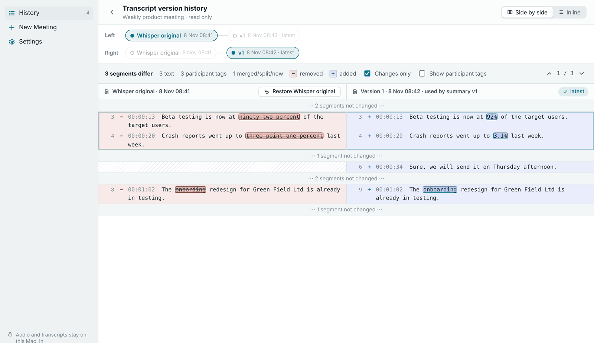

### ▶️ Read along while you listen

With the Interactive Transcript, the text follows the recording as it plays: the line being spoken is marked and the current word is highlighted. Click any word to jump to that moment.

### 👁️ Easy to use

A clean, simple screen in light or dark mode. Keyboard shortcuts cover the common steps, and every change is clearly marked, so you see at once what was added or removed.

## Where your data goes

The recording and the audio never leave your Mac. Only the masked transcript text goes to the AI you choose, and only after you confirm. The masked values are put back on your Mac.

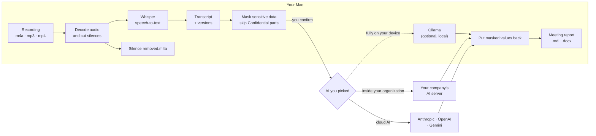

| Step | Where it runs | Leaves your Mac? |
| --- | --- | --- |
| Decode audio, remove silences | Your Mac (ffmpeg) | No |
| Speech-to-text | Your Mac (mlx-whisper) | No. Only the first run downloads the speech model. |
| Masking, Confidential parts | Your Mac | No |
| AI report and AI suggestions | The AI you picked | Masked text only, after you confirm. With Ollama: no. |
| API keys | macOS Keychain | Only to the provider they belong to |
| App server | `127.0.0.1` with a session token | Not reachable from the network |
| Send history and log | Your Mac | No. Counts only, never the transcript text. |

## How it compares

| | Meeting Report | Cloud transcription services | AI recorder devices | Taking notes by hand |
| --- | --- | --- | --- | --- |
| Your recording is uploaded somewhere | ✕ No, it stays on your device | ✓ Yes, uploaded to a server | ✓ Usually, to the vendor's cloud | ✕ No |
| Works without internet | ✓ Yes | ✕ No | ✕ Usually not | Not applicable |
| Masks sensitive data before AI | ✓ Automatic | ✕ Rarely | ✕ Rarely | Not applicable |
| Can make the AI report fully in-house | ✓ Yes, on your device or your company's server | ✕ No | ✕ No | Not applicable |
| Choose your own AI (or run it locally) | ✓ 5 options, including Ollama | ✕ Set by the vendor | ✕ Set by the vendor | Not applicable |
| Cost | No subscription; you pay only your AI provider, if any | Monthly subscription | Device price + subscription | Your time |
| Transcript versions and word-by-word compare | ✓ Yes | Limited | Limited | ✕ |

## How it works

1. **Add your recording.** Drag in an audio file or a screen recording (mp4, mov, webm; files over 1 GB are fine). Add a title, the language and, if you like, the list of attendees.

   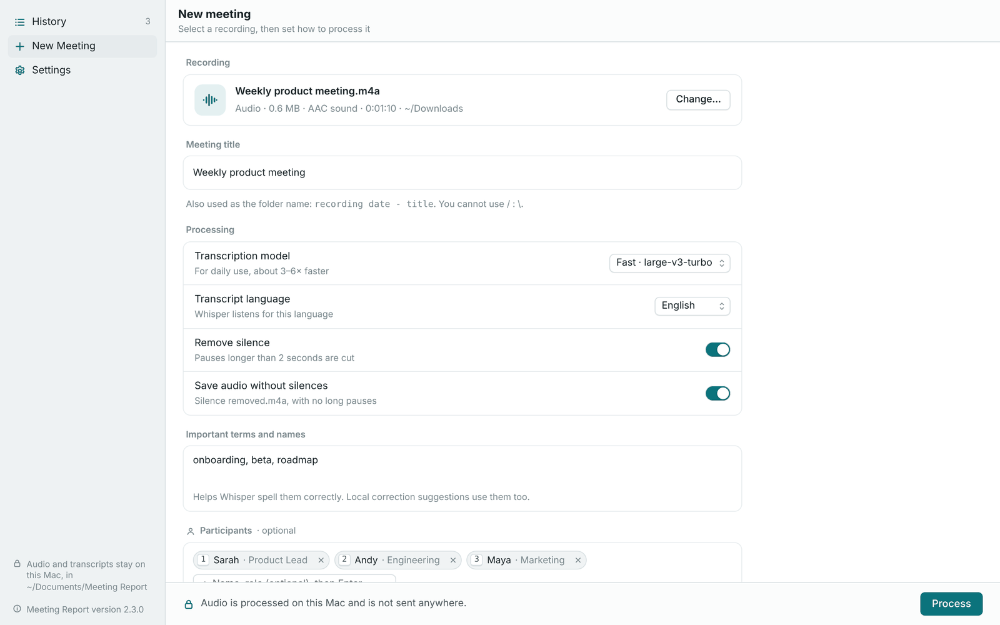

2. **Let speech-to-text do the work.** Choose **Fast** or **Accurate**. You see the progress and the time left. You can close the window while it works.

   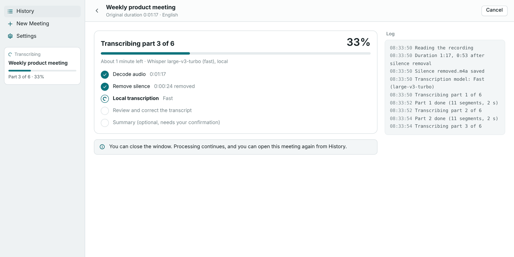

3. **Review and tag speakers.** Press 1 to 9 to tag who is speaking. Accept or reject spelling suggestions.

   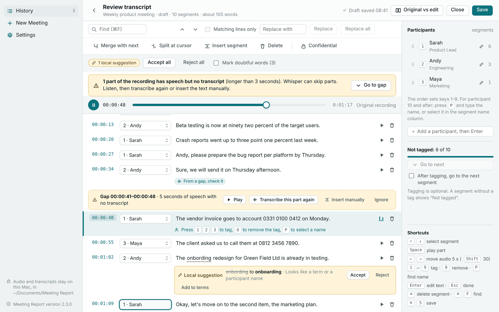

4. **Create the report.** One click gives you the summary, the decisions and the action items with owners. If you edit the transcript later, the app tells you the report is out of date.

   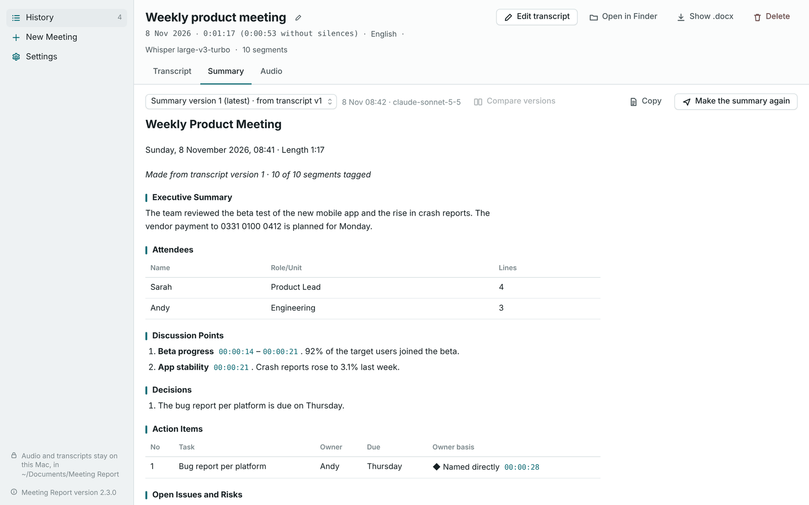

5. **Listen back with the Interactive Transcript.** In the Audio tab, play the silence-removed audio or the original recording. The line being spoken shows a ▶ mark, and the current word is highlighted. Click a word or a timestamp to play from there. Keys: Space play/pause, ← → 5 seconds, ↑ ↓ previous/next line, F follow audio, W word highlight, [ ] speed. Meetings processed before v1.6 use estimated word timing (marked ≈).

## Who it is for

- Teams that record internal meetings and cannot upload them to a cloud service
- Managers and secretaries who write minutes after every meeting
- Anyone who wants a searchable record of interviews, workshops or calls

## What you get for each meeting

Each meeting gets its own folder in `~/Documents/Meeting Report/`. The file names are always in English, whatever the app language:

| File | What is inside |
| --- | --- |
| `Transcript.txt` | The latest transcript with speaker names |
| `Original transcript.txt` | The original machine transcript, never changed |
| `Summary.md` / `.docx` | The latest meeting report |
| `Silence removed.m4a` | The recording without long silences (optional) |
| `Original audio.m4a` | The sound of a video recording, so it can play in the app (video only) |
| `versions/`, `summaries/` | Every version of the transcript and the report, plus the timing of each word for the Interactive Transcript |

## Get started

**You need:** a Mac with Apple Silicon (M1 or newer), macOS 13 or newer, and about 4 GB of free space.

1. Install [Homebrew](https://brew.sh) if you do not have it. Follow the one-line instruction on its home page.
2. Open the **Terminal** app (press ⌘ Space, type `Terminal`, press Return).
3. Copy and paste these three lines, then press Return:

   ```bash
   git clone https://github.com/odorifqi/meeting-reports.git
   cd meeting-reports
   ./install.sh
   ```

4. Open **Meeting Report** from Finder > Applications.

The first speech-to-text run downloads the speech model once. After that, it works offline.

## Questions

### Does my audio go to the internet?

No. Speech-to-text runs on your device. Only the text for the report goes to the AI you choose, after you confirm, with sensitive data masked. With Ollama, nothing leaves your device at all.

### Can I use my company's own AI server?

Yes. In Settings, choose the OpenAI-compatible provider and enter your server's address. Your IT team chooses and runs the model, so the report never leaves your organization.

### Does it cost anything?

There is no subscription. If you use a cloud AI for reports, you pay that provider for what you use. Ollama is free.

### Which languages does it support?

You choose the language of each recording. The speech engine (Whisper) supports many languages, including English and Indonesian.

The app itself is in English or Indonesian. By default it follows the language of macOS. You can change it in Settings → App language. Feature names such as Interactive Transcript stay in English in both. The meeting report can be in English or Indonesian too, whatever language was spoken. Set the default in Settings → Report language, or pick it for each meeting when you make the summary.

### Does it work on Windows?

Not yet. Meeting Report needs a Mac with Apple Silicon.

### Something does not work.

Check the log at `~/Library/Application Support/MeetingNotes/logs/server.log`. The log never contains your transcript.

<details>
<summary><strong>For developers</strong></summary>

```bash
./run.sh dev    # server with auto-reload, opens in the browser
./run.sh app    # Mac window that uses the code in this repo
./run.sh test   # automated tests (pytest)
```

Try it without real data: `MN_OUTPUT_DIR=~/Desktop/mn-test ./run.sh dev`. `tests/demo_server.py` runs the UI with a fake speech engine and a fake AI.

Architecture: FastAPI on `127.0.0.1:8765` with a session token, an HTML/CSS/JS UI with no build step in a pywebview (WKWebView) window, and transcription with mlx-whisper. The server stops 30 minutes after the window closes.

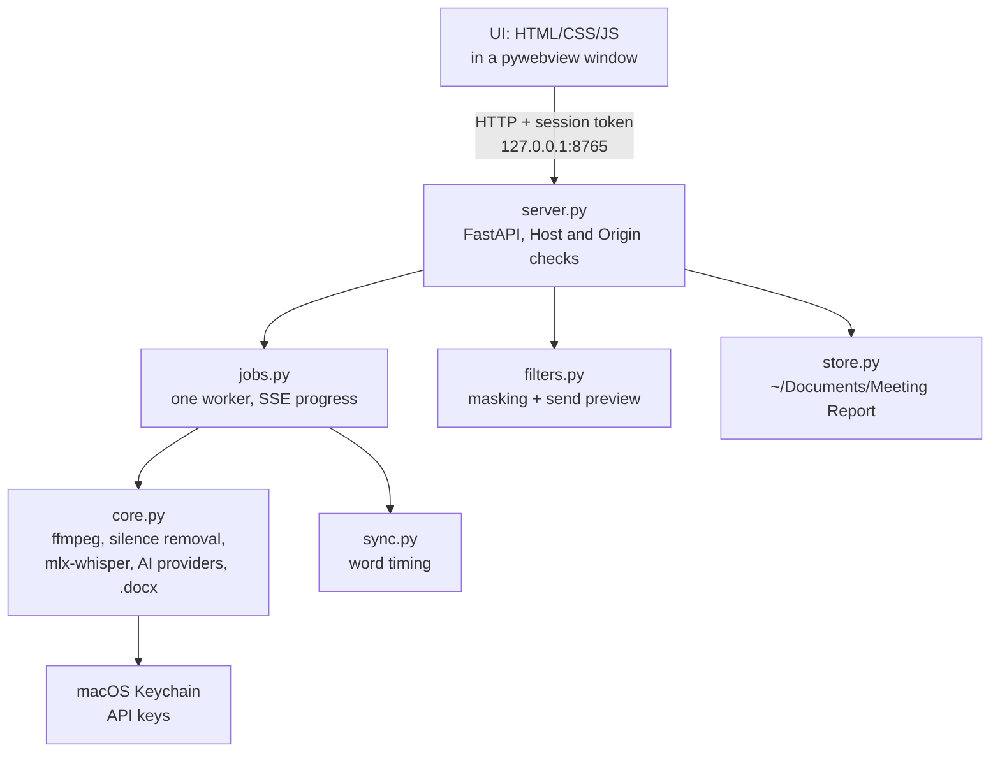

```
app/core.py      audio, silence removal, Whisper per chunk, AI providers, .docx
app/store.py     meeting folders, versions, reports
app/filters.py   sensitive-data filter and send preview
app/suggest.py   local spelling suggestions and AI suggestions
app/sync.py      Interactive Transcript: word timing per version, clean-audio time map
app/jobs.py      transcription and report worker, SSE events
app/server.py    FastAPI and local security
app/main.py      .app launcher
app/static/      UI
tests/           pytest
```

</details>

## License

Copyright (C) 2026 Muhammad Rifqi (odorifqi)

Meeting Report is free software. You can use, study, change and share it under the terms of the [GNU Affero General Public License v3.0](LICENSE) (AGPL-3.0-only).

If you share a changed version, or let other people use it over a network, you must also share its full source code under the same license.

Meeting Report comes with no warranty. The third-party components and their licenses are listed in [THIRD-PARTY-NOTICES.md](THIRD-PARTY-NOTICES.md).
